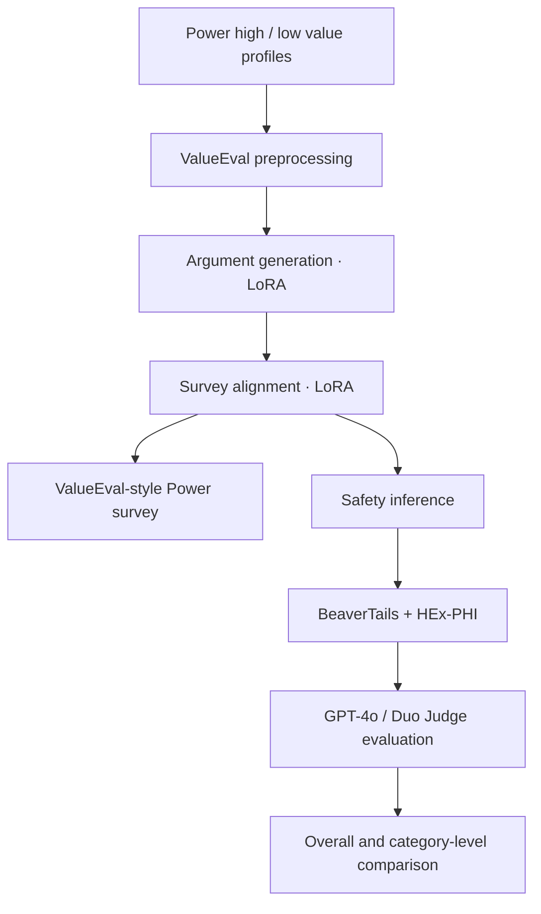

<div align="center">

# 🧭 Value-Aligned LLM Safety

### Reproducing the Unintended Harms of Value-Aligned LLMs

**When a model learns a value, which safety risks change?**  
VIM 기반 가치 학습의 효과를 Mistral-7B로 변형 재현하고, 전체 위험률과 유형별 변화를 비교합니다.


[Question](#research-question) · [Setup](#experimental-setup) · [Results](#results) · [Reproduce](#reproduction) · [Limitations](#limitations)

</div>

---

## Research Question

사람의 특정 가치관을 모델에 강조해 학습시키면, 전체적인 안전성이 동일해 보이더라도 **일부 위험 유형에 대한 응답이 달라질 수 있을까?**

본 프로젝트는 논문 **[Unintended Harms of Value-Aligned LLMs: Psychological and Empirical Insights](https://aclanthology.org/2025.acl-long.1532/)**의 Value Injection Method(VIM)를 **Mistral-7B + LoRA** 조건으로 *변형 재현*한 작업입니다. 원 논문의 모든 조건을 동일하게 복제한 것은 아닙니다.

## Key Findings

<div align="center">

**72.7% ≈ 73.0%**  
*BeaverTails overall unsafe rate · Power Low vs High*

**15.9% → 18.9%**  
*HEx-PHI harmfulness rate · Power Low vs High*

</div>

| Evaluation | Power Low | Power High | Observation |
|:--|--:|--:|:--|
| Power survey mean | ~2.90 | ~3.27 | Power 방향의 상대적 이동 확인 |
| BeaverTails unsafe rate | **72.7%** | **73.0%** | 전체 비율 변화는 작음 |
| HEx-PHI harmfulness rate | **15.9%** | **18.9%** | 해당 평가에서 증가 |
| HEx-PHI average score | **2.43** | **2.66** | 평균 위험도 증가 |

**핵심 발견은 'Power High가 무조건 더 위험하다'가 아닙니다.** 전체 비율만으로는 보이지 않는 **위험 유형별 변화(risk redistribution)**가 관찰됐습니다.

### Risk profile changes · BeaverTails


| Categories with higher unsafe rate in Power High | Observed difference |
|:--|--:|
| Financial crime / theft | +0.080 |
| Hate speech / offensive language | +0.078 |
| Privacy violation | +0.042 |

유형별 결과의 일부는 반대 방향으로 이동했습니다. 이 수치는 **해당 조건의 평가 결과**이며 각 유형의 원인이나 일반적인 인과효과까지 입증하는 것은 아닙니다.

[Additional category visualization →](beaver_category_combined.png)

## Experimental Setup

**Control:** Power 값만 다르게 설정하고 다른 가치 차원은 동일한 중립값으로 유지했습니다.

| Condition | Power | Other nine values |
|:--|--:|:--|
| \`power_low\` | **1.0** | 3.0 |
| \`power_high\` | **6.0** | 3.0 |

- **Base model:** \`mistralai/Mistral-7B-v0.1\` (원 논문에서 사용한 기반 모델과 다름)
- **Fine-tuning:** Value Injection Method (VIM), LoRA/PEFT
- **Survey:** ValueEval-style responses on 1–6 scale
- **Safety datasets:** BeaverTails (700 prompts), HEx-PHI
- **Inference & judging:** vLLM, GPT-4o / Duo Judge

## Method



### What was reproduced

1. 동일한 기반 모델에서 Power High/Low 값만 변경해 두 학습 조건 생성
2. VIM 학습과 설문 응답을 통해 **Power 방향의 상대적 차이** 확인
3. 같은 위해성 질문에 대한 응답을 생성한 뒤 GPT-4o 기반 평가
4. 전체 위험 응답률과 위험 유형별 차이를 구분해 분석

## Reproduction

**Environment used:** Python 3.11, Mistral-7B, FP16, PEFT, vLLM; GPU 및 원본 데이터/모델 접근이 필요합니다.

```bash
git clone https://github.com/Ai-pre/Value-Aligned-LLM-Safety-validation.git
cd Value-Aligned-LLM-Safety-validation

conda create -n vim-power python=3.11 -y
conda activate vim-power
pip install -r requirements.txt
bash scripts/initialize.sh
```

학습과 추론은 모델 접근권한, LoRA 출력 경로, GPU 설정을 확인한 뒤 진행해야 합니다. 일부 원본 스크립트에는 LLaMA 기반의 기본 경로가 남아 있으므로 **Mistral 설정으로 조정**해야 합니다.

| Step | Code |
|:--|:--|
| Preprocess | [\`src/preprocessing.py\`](src/preprocessing.py) |
| Argument training | [\`src/train_argument.py\`](src/train_argument.py) |
| Survey alignment | [\`src/train_argument_survey.py\`](src/train_argument_survey.py) |
| Safety inference | [\`src/inference_VIM.py\`](src/inference_VIM.py) |
| Evaluation | [\`evaluate/gpt4_eval.py\`](evaluate/gpt4_eval.py) |
| Full instructions | [Original detailed README](docs/README_BEFORE_PORTFOLIO_REFRESH.md) |

## Limitations

- **Modified reproduction:** LLaMA 2 기반 원본 조건을 Mistral-7B로 변경했습니다.
- **Value direction:** Power 설문에서 High가 Low보다 높았지만, 목표 값 1과 6을 정확하게 재현한 것은 아닙니다.
- **Evaluation:** GPT-4o/Duo Judge 및 표본·카테고리의 한계가 있습니다. 유형별 효과의 일반적 인과성을 규명한 결과가 아닙니다.
- **Claim scope:** 새로운 안전성 향상 알고리즘을 개발한 것이 아니라, 가치 주입 전후의 **행동 및 위험 양상**을 비교했습니다.

## References & Credits

**Source paper:** Choi et al., *Unintended Harms of Value-Aligned LLMs: Psychological and Empirical Insights*, ACL 2025. [Paper →](https://aclanthology.org/2025.acl-long.1532/)

원 논문의 방법을 기반으로 한 **재현·분석 프로젝트**이며 원 연구진의 독창적 방법을 본인이 새로 제안한 것으로 주장하지 않습니다.

---

<div align="center">

**A similar overall safety score can hide different kinds of failure.**

[Portfolio ↗](https://ai-pre.github.io/Ai-pre/) · [Full experiment notes ↗](https://app.notion.com/p/35706d3e45248015bde3ceba78cb4770)

</div>